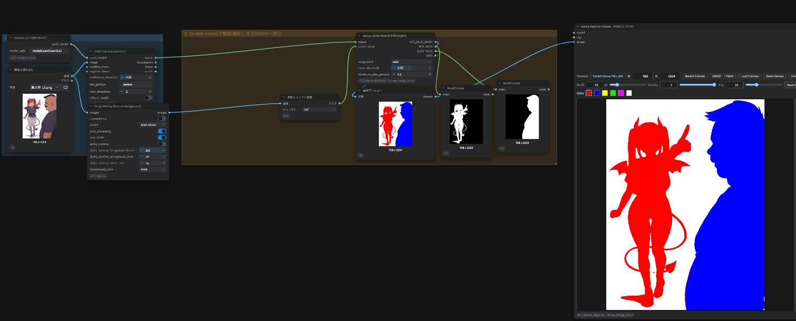

# Anima Regional Canvas Image Input

`Anima Regional Canvas（IMAGE入力対応）` は、ComfyUI 上で色分けされた領域画像を直接受け取り、ANIMA / Anima-LLLite の地域別プロンプト制御に利用するためのカスタムノードです。

手描きキャンバスに加えて、SAM3などの外部セグメンテーション処理で作成した赤・青の領域画像を入力できます。入力画像の色を人物認識するノードではなく、既に色分けされた画像から地域マスクを作り、対応するプロンプトを地域別CONDITIONINGとして出力するノードです。

> [!IMPORTANT]
> このプロジェクトは、[ukr8b3g-cmyk/Anima_Regional_Canvas](https://github.com/ukr8b3g-cmyk/Anima_Regional_Canvas) を基礎として作成した派生拡張です。元プロジェクトのキャンバスUI、色別マスク処理、地域別CONDITIONING、LATENTおよびMETADATA生成などの設計・実装を活用し、IMAGE入力、IMAGEからペイント面への取込み、SAM3用MASK変換、STRING出力などを追加・変更しています。詳細は「[元プロジェクトへの謝辞と派生関係](#元プロジェクトへの謝辞と派生関係)」を参照してください。

## 主な機能

- ComfyUIの`IMAGE`を地域画像として直接入力
- 入力IMAGEの実寸からキャンバスとLATENTサイズを自動決定
- 赤・青・黄・緑・マゼンタの5色を地域として認識
- 地域色ごとに個別プロンプトを適用
- 接続IMAGEを`IMAGE → Paint`で編集可能なペイント面へ取り込み
- IMAGE未接続時は従来どおり手描きキャンバスとして使用
- `POSITIVE` / `NEGATIVE`のCONDITIONINGに加えて、結合済み`POSITIVE_TEXT` / `NEGATIVE_TEXT`をSTRINGで出力
- SAM3のMASKバッチから独立した2人物を選び、赤・青IMAGEへ変換
- ComfyUI Nodes 2.0の非表示ウィジェットとレイアウトへ対応
- 元の`Anima_Regional_Canvas`とは異なるノードIDを使用するため、両方を同時に導入可能

## ノード一覧

### Anima Regional Canvas（IMAGE入力対応）

内部ノードID: `AnimaRegionalCanvasImageInput`

地域画像、地域別プロンプト、空LATENT、およびKSampler用CONDITIONINGを生成する中心ノードです。

#### IMAGE入力時の動作

1. `image`が接続されている場合、入力IMAGEを地域画像として使用します。
2. 幅と高さは入力IMAGEから取得し、LATENT互換の8の倍数へ調整します。
3. ノード上の`width` / `height`はIMAGE入力中には使用しません。
4. `IMAGE → Paint`を押すと、接続IMAGEを編集可能なキャンバスへ複製します。
5. 取込み後はペイントしたキャンバスが地域判定に使われます。

`IMAGE → Paint`は入力元のIMAGEそのものを書き換えません。ノード内部のペイント用コピーを編集します。

`Clear`はノード内部のペイント内容を白紙にし、接続IMAGEへ自動では戻りません。接続IMAGEをもう一度取り込みたい場合は、改めて`IMAGE → Paint`を押してください。`Undo`はペイント内容と、接続IMAGE／ペイントのどちらを使うかという状態をまとめて1段階戻します。

#### IMAGE未接続時の動作

ノード内のキャンバスへ直接描画します。`width` / `height`がキャンバスとLATENTのサイズになります。

#### 認識する地域色

| 色 | 対応プロンプト | RGBの目安 |
|---|---|---|
| 赤 | `red_prompt` | `255, 0, 0` |
| 青 | `blue_prompt` | `0, 0, 255` |
| 黄 | `yellow_prompt` | `255, 255, 0` |
| 緑 | `green_prompt` | `0, 255, 0` |
| マゼンタ | `magenta_prompt` | `255, 0, 255` |
| 白・その他 | 地域外／ベース | `255, 255, 255`など |

JPEG圧縮、ぼかし、色補正などで色が大きく変化すると、地域色として認識されない場合があります。領域画像にはPNGなどの可逆形式と明確な原色を推奨します。

#### プロンプト

- `quality_prompt`: 品質・画風など全体へ適用する内容
- `scene_prompt`: 人数、背景、状況など全体へ適用する内容
- `red_prompt`～`magenta_prompt`: 対応する色領域だけへ適用する内容
- `negative_prompt`: NEGATIVE CONDITIONINGへ渡す内容
- `regional_enabled`: 地域別CONDITIONINGの有効／無効
- `region_strength`: 地域MASK付きCONDITIONINGの強度

`region_strength`は地域別CONDITIONINGの強度です。Anima LLLite自体の強度設定ではなく、領域を完全に固定する機能でもありません。

#### 出力

| 出力 | 内容 |
|---|---|
| `IMAGE` | Anima LLLiteへ渡す色分け地域画像 |
| `MODEL` | 入力MODELのパススルー |
| `POSITIVE` | 地域MASK付きPOSITIVE CONDITIONING |
| `NEGATIVE` | NEGATIVE CONDITIONING |
| `LATENT` | 地域画像と同じサイズの空LATENT |
| `METADATA` | サイズ、モード、プロンプトなどのJSON文字列 |
| `MASK_PREVIEW` | 地域確認用のプレビュー画像 |
| `POSITIVE_TEXT` | 空でない正プロンプトを`, `で結合したSTRING |
| `NEGATIVE_TEXT` | ネガティブプロンプトのSTRING |

### Anima: SAM3 MASKを赤青IMAGE化

内部ノードID: `SAM3MasksToRedBlueImage`

SAM3などが出力した`MASK`バッチから、面積条件を満たす独立した2枚を選び、1人目を赤、2人目を青にしたIMAGEを生成します。このノード自体は人物を検出しません。

- `assignment = auto`: 重心差から左右配置または上下配置を判定
- `left-right`: 左を赤、右を青
- `top-bottom`: 上を赤、下を青
- `mask_threshold`: 入力MASKを二値化する閾値
- `minimum_area_percent`: 小さすぎるMASKを除外する面積条件
- `anime_mask`（任意）: 全体前景MASKから、SAM3が取りこぼした未割当部分だけを補完

2枚の独立したMASKを取得できない場合は、誤った赤青領域を生成せずエラーで停止します。SAM3が2人物を1枚のMASKへ統合した場合、このノードだけで人物を正しく分離することはできません。

### Anima: Anime Instance MASKを赤青IMAGE化

内部ノードID: `AnimeInstanceMasksToRedBlueImage`

入力元に依存しない名称で同じ2MASK変換処理を利用するための互換ノードです。アニメ人物検出モデルそのものは含まれていません。

> [!WARNING]
> AnimeInstanceSegmentationを使用する同梱ワークフローは実験用です。画像やモデルによって2人物を検出できない場合や、輪郭補正でMASKが統合される場合があります。安定した品質を保証するものではありません。

## 必要なもの

### 基本構成

- 現行のComfyUI
- ANIMA対応モデル
- 対応するCLIP / VAE
- [Anima-LLLite Regional ControlNet](https://huggingface.co/Sen-sou/Anima-LLLite-Regional-Controlnet)
- `anima-lllite-regional-exp-v3.safetensors`

Anima LLLiteモデルは通常、次へ配置します。

```text
ComfyUI/models/model_patches/anima-lllite-regional-exp-v3.safetensors
```

このリポジトリには生成モデル、VAE、CLIP、LoRA、SAM3モデルを同梱していません。

### SAM3ワークフローを使う場合

- [PozzettiAndrea/ComfyUI-SAM3](https://github.com/PozzettiAndrea/ComfyUI-SAM3)
- ComfyUI Manager上の識別子: `comfyui-sam3`
- SAM3モデル
- [WAS Node Suite](https://github.com/WASasquatch/was-node-suite-comfyui)の`Image Rembg (Remove Background)`ノード（同梱ワークフローの輪郭補助を使う場合）

同梱ワークフローは、SAM3モデルを次の場所として参照します。

```text
ComfyUI/models/sam3/sam3.pt
```

SAM3拡張のバージョンによってモデルの取得方法やノード入力が変わる可能性があります。モデルの導入方法はSAM3拡張側のREADMEも確認してください。

## インストール

このリポジトリをComfyUIの`custom_nodes`へ配置します。

```powershell
cd C:\path\to\ComfyUI\custom_nodes
git clone https://github.com/ukr8b3g-cmyk/Anima_Regional_Canvas_Image_Input.git
```

配置例:

```text
ComfyUI/
└─ custom_nodes/
   └─ Anima_Regional_Canvas_Image_Input/
      ├─ __init__.py
      ├─ nodes.py
      ├─ web/
      └─ workflows/
```

インストール後はComfyUI本体を再起動してください。Pythonノード定義とフロントエンド拡張を起動時に読み込むため、ブラウザの再読み込みだけでは新しいノードが登録されない場合があります。

元の`Anima_Regional_Canvas`は必須依存ではありません。本拡張は別ノードIDで登録されるため、元拡張を残したまま併用できます。

## 基本接続

```text
Load Model Patch MODEL_PATCH ──> Apply Anima LLLite model_patch
Anima Regional Canvas（IMAGE入力対応） IMAGE ──> Apply Anima LLLite image
Anima Regional Canvas（IMAGE入力対応） MODEL ──> Apply Anima LLLite model
Apply Anima LLLite MODEL ──> KSampler model
Anima Regional Canvas（IMAGE入力対応） POSITIVE ──> KSampler positive
Anima Regional Canvas（IMAGE入力対応） NEGATIVE ──> KSampler negative
Anima Regional Canvas（IMAGE入力対応） LATENT ──> KSampler latent_image
KSampler LATENT ──> VAE Decode
```

Anima LLLiteは赤青画像を人物検出する機能ではありません。入力された色分け領域を生成時の空間誘導として利用します。地域別CONDITIONINGとAnima LLLiteは誘導を強めますが、境界からのはみ出しや人物特徴の混在を完全には禁止できません。

## IMAGE入力の使用手順

1. 赤・青などで塗られた領域画像を用意します。
2. `Load Image`の`IMAGE`を`Anima Regional Canvas（IMAGE入力対応）`の`image`へ接続します。
3. 色に対応する地域プロンプトを入力します。
4. Canvasノードの`IMAGE`を`Apply Anima LLLite`へ接続します。
5. Canvasノードの`POSITIVE`、`NEGATIVE`、`LATENT`をKSamplerへ接続します。
6. 接続画像を手直しする場合は`IMAGE → Paint`を押してから描画します。

## SAM3の使用手順

```text
Load Image
  └─> SAM3Grounding
        └─ MASK ─> Anima: SAM3 MASKを赤青IMAGE化
                     └─ RED_BLUE_IMAGE ─> Anima Regional Canvas（IMAGE入力対応）
```

1. SAM3へ人物画像を入力します。
2. テキストプロンプトなどで人物MASKを取得します。
3. SAM3が2人物を別々のMASKとして出力していることを確認します。
4. `Anima: SAM3 MASKを赤青IMAGE化`へMASKバッチを接続します。
5. `RED_BLUE_IMAGE`をCanvasノードの`image`へ接続します。

SAM3がアニメ絵を必ず正しく認識する保証はありません。重なり、接触、極端な構図、デフォルメ、衣装などによって2人が1MASKになる場合があります。

## 同梱ワークフロー

### 推奨

`workflows/SAM3_to_Anima_Regional_Canvas_Image_Input.json`

SAM3による人物MASK生成、赤青IMAGE化、IMAGE入力対応Canvas、Anima LLLite、1つのKSamplerまでを接続した例です。使用環境のモデル名に合わせてUNET、CLIP、VAE、LoRAを選び直してください。

### 実験用

`workflows/AnimeInstanceSeg_to_Anima_Regional_Canvas_Image_Input.json`

外部の`AdvancedAnimeInstanceSeg`ノードを使う実験用ワークフローです。その検出ノードとモデルは本リポジトリに含まれません。2人物の安定検出を保証しないため、主要ワークフローとしてはSAM3版を推奨します。

既存のモデル名、LoRA名、保存ノードなどは環境ごとに異なります。ワークフローJSONを読み込んだだけで全依存関係が自動導入されるわけではありません。

## 制限事項

- 本拡張は入力画像の意味を理解して人物を認識するものではありません。
- IMAGE入力は、事前に赤・青・黄・緑・マゼンタへ色分けされている必要があります。
- SAM3変換ノードは、入力MASKの中に独立した2人物MASKがあることを前提とします。
- `region_strength`やAnima LLLiteを強くしても、生成結果をピクセル単位で領域内へ拘束することはできません。
- 人物の接触や大きな重なりでは、キャラの合体、特徴混在、領域越境が発生する場合があります。
- 入力IMAGEのサイズは8の倍数へ調整されます。
- 大きなキャンバスや多数バッチはRAM／VRAMを多く消費します。
- 外部ノードの更新により、同梱ワークフローの入力項目やモデル配置が変わる場合があります。

## トラブルシューティング

### 「独立した人物MASKを2枚取得できませんでした」

赤青変換ノードへ、条件を満たす別々のMASKが2枚届いていません。

- SAM3の検出結果をプレビューする
- SAM3のテキスト、ポイント、ボックス、confidence設定を調整する
- `mask_threshold`と`minimum_area_percent`を確認する
- 2人が1枚のMASKへ統合されている場合は、SAM3側で別々に検出し直す

赤青変換ノードは、不確かな1枚のMASKを機械的に半分へ切って2人物とみなす処理は行いません。

### IMAGEを接続したのにペイント面へ表示されない

一度キューを実行して接続IMAGEのプレビューを取得し、その後`IMAGE → Paint`を押してください。

### READMEどおりのノードが表示されない

Pythonノード定義またはフロントエンドJavaScriptがまだ読み込まれていない可能性があります。ComfyUI本体を完全に終了して再起動し、その後ブラウザを再読み込みしてください。

## テスト

Python側の入出力契約とMASK変換:

```bash
python -m unittest discover -s tests -p "test_*.py" -v
```

フロントエンド契約:

```bash
node tests/test_frontend_contract.mjs
```

これらはノードの入出力、色マスク、STRING出力、IMAGE取込み契約を確認するテストです。ComfyUI全体でのモデル読込み、SAM3の認識品質、最終生成画像の品質を保証するテストではありません。

## 元プロジェクトへの謝辞と派生関係

本プロジェクトは、**ukr8b3g-cmyk氏による [Anima Regional Canvas](https://github.com/ukr8b3g-cmyk/Anima_Regional_Canvas)** を基礎として開発した派生拡張です。

元プロジェクトが公開した次の設計・実装を活用し、IMAGE入力用途へ拡張しています。

- ComfyUI内で色分け領域を描画するキャンバスUI
- 赤・青・黄・緑・マゼンタの地域色とプロンプトの対応
- 地域色からMASKを生成する処理
- ComfyUIのMASK付きCONDITIONINGを組み立てる処理
- 空LATENT、MASKプレビュー、METADATAの生成
- 品質、シーン、地域、ネガティブを分けたプロンプト構成
- Anima LLLiteへ渡す地域画像を中心としたワークフロー設計

この基盤が公開されていなければ、本拡張を同じ形で作成することはできませんでした。実用的な地域キャンバスの設計と実装をMIT Licenseで公開された元作者に、深く感謝します。

本拡張で追加・変更した主な点は次のとおりです。

- 任意のComfyUI `IMAGE`入力
- 入力IMAGEに追従するサイズ処理
- `IMAGE → Paint`による接続画像の編集用取込み
- ペイント画像と接続IMAGEの使用切替
- `POSITIVE_TEXT` / `NEGATIVE_TEXT`のSTRING出力
- SAM3のMASKバッチを赤青IMAGEへ変換する補助ノード
- 任意の全体前景MASKによる未割当輪郭の補完
- Anime Instance MASK用の互換ノード
- ComfyUI Nodes 2.0向けの表示・レイアウト対応

元プロジェクト:

- Repository: <https://github.com/ukr8b3g-cmyk/Anima_Regional_Canvas>
- Author / copyright holder: `ukr8b3g-cmyk`
- License: MIT License
- Original copyright notice: `Copyright (c) 2026 ukr8b3g-cmyk`
- README作成時に参照・照合した元実装: [`50b9d87f302cf9e261a871863438ddf2de5b61e6`](https://github.com/ukr8b3g-cmyk/Anima_Regional_Canvas/commit/50b9d87f302cf9e261a871863438ddf2de5b61e6)

元プロジェクトの著作権表示とMIT License本文は、本リポジトリの[`LICENSE`](LICENSE)に保持しています。本拡張の利用・改変・再配布時も、`LICENSE`に記載された著作権表示および許諾表示を保持してください。

### Acknowledgement in English

This project is a derivative extension based on [Anima Regional Canvas](https://github.com/ukr8b3g-cmyk/Anima_Regional_Canvas), created and released by `ukr8b3g-cmyk` under the MIT License. It reuses and adapts the original project's regional canvas UI, color-mask processing, masked conditioning, latent/metadata generation, and ANIMA regional-control workflow design, while adding direct IMAGE input, IMAGE-to-paint import, STRING outputs, mask-to-red/blue adapters, and Nodes 2.0 compatibility. We sincerely thank the original author for making the project and its source code available. The original copyright and license notice are preserved in [`LICENSE`](LICENSE).

## ライセンス

MIT Licenseです。詳細は[`LICENSE`](LICENSE)を確認してください。

外部モデル、ComfyUI、SAM3拡張、ANIMA、Anima-LLLiteには、それぞれ個別のライセンスと利用条件があります。本リポジトリのMIT Licenseが、それら外部ソフトウェアやモデルへ適用されるわけではありません。各配布元の条件を確認してください。

## 免責事項

本ソフトウェアはMIT Licenseに基づき、無保証で提供されます。生成結果、モデルの利用条件、外部拡張との互換性、第三者の権利、公開先サービスの規約については、利用者自身で確認してください。
